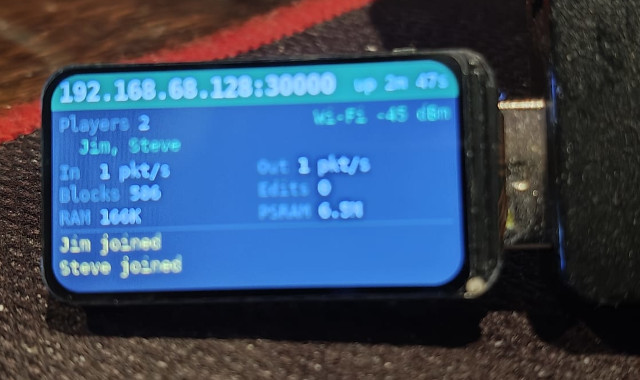
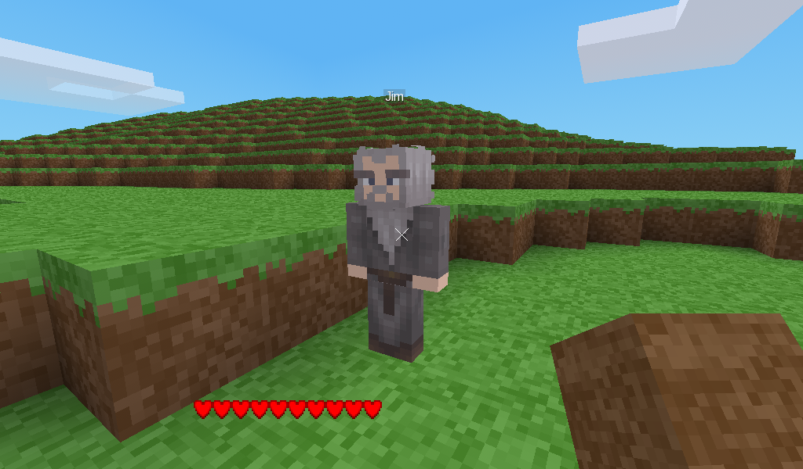
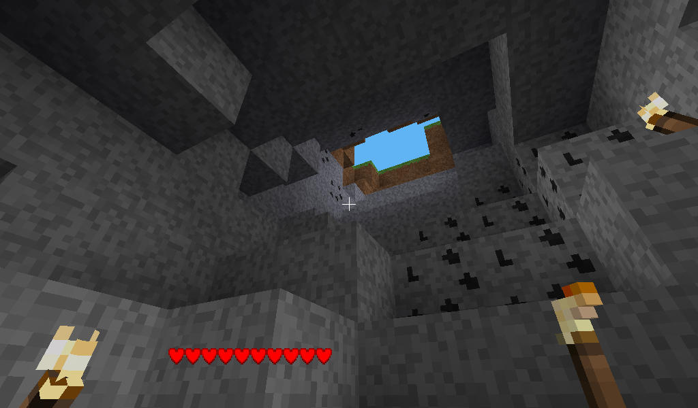
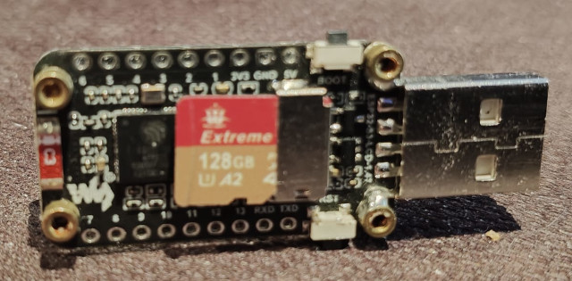

# esp32-s3-luanti

A minimal [Luanti](https://www.luanti.org/) (formerly Minetest) server that runs on an ESP32-S3 microcontroller, written in Rust on ESP-IDF.

A standard, unmodified Luanti client connects to it over Wi-Fi as it would to any server. You can create an account, log in, explore a generated world with hills, forests, caves, biomes and ores, dig and build, craft, place torches, drop and pick up items, choose a skin, and see the other players. The world, accounts, inventories and player positions are stored on a microSD card. The board's small LCD shows the server's status.

The server does not run Lua. A normal Luanti server runs a game (such as Minetest Game) written in Lua mods. This one implements the engine's network protocol directly and builds a small built-in game on top of it, in about 7,000 lines of Rust.



## What it looks like

A Luanti client playing on the ESP32:





## Hardware

Developed on a [**Waveshare ESP32-S3-LCD-1.47**](https://www.waveshare.com/product/esp32-related/boards-kits/esp32-s3-lcd-1.47.htm):

| | |
|---|---|
| Chip | ESP32-S3, dual-core Xtensa LX7 at 240 MHz |
| RAM | 512 KB internal SRAM, plus 8 MB octal PSRAM |
| Flash | 16 MB |
| Display | 1.47" ST7789 LCD, 172 × 320 |
| Storage | microSD slot (4-bit SDMMC) |
| Network | 2.4 GHz Wi-Fi |



Other ESP32-S3 boards with PSRAM and an SD card should work with pin changes. The SD card pins are set in `src/main.rs` (CMD 15, CLK 14, D0 16, D1 18, D2 17, D3 21) and the LCD pins in `src/lcd.rs`. PSRAM is required: the server keeps its own data there and leaves the internal RAM to Wi-Fi and the system.

## What works

- **Protocol:** the Luanti network protocol as spoken by Luanti 5.17 (protocol version 53), including the reliable-UDP layer with split packets, acknowledgements, resends and out-of-order delivery.
- **Accounts:** SRP-6a password login, the same scheme the real server uses. New players register on first connect, and passwords are never stored or sent.
- **World generation:**
  - rolling hills and mountains;
  - grassland, desert and snow biomes;
  - caves with entrances;
  - coal and iron ore;
  - birch woods with apple trees in the lowlands and fir forests in the hills and snow, with clearings and the odd lone tree; leaves cast shade.
- **Trees, as in Minetest Game:** chop a tree's trunk away and its leaves fall within a few seconds (leaves you placed yourself never do). Leaves give a sapling one time in 20, dug or fallen. Plant a sapling on dirt or grass in the open and it grows into a birch, fir or apple tree after 5 to 25 minutes, in daylight.
- **Apples and health:** apple trees carry apples. Pick one (punch it) and eat it (left-click with it) for 2 HP; health only comes back by eating, as in Minetest Game. A picked apple grows again in the same place after 5 to 25 minutes while the tree's leaves are there; apples fall with the leaves when the tree is chopped.
- **World edge:** the world ends about 31,000 nodes from the centre in every direction, at an invisible wall, as in Luanti.
- **World storage:** the world is generated on demand from a fixed seed. Only the changes players make are stored, as an append-only log on the SD card.
- **Digging and building:** changes appear for every player at once.
- **Survival inventory:** 32 slots, with stacks you can rearrange in the inventory window. New players start with 20 torches.
- **Crafting:** Minetest Game's 3×3 crafting grid in the inventory window, with its recipes and rules. Stone gives cobblestone, and ores give coal and iron lumps.
  - a tree trunk makes 4 planks; planks make 4 sticks;
  - a coal lump above a stick makes 4 torches;
  - 4 sand make sandstone, and sandstone makes 4 sand;
  - wooden and stone pickaxes, shovels, axes and swords, in Minetest Game's shapes (planks for wood, stone or cobblestone for stone);
  - a furnace from 8 stone or cobblestone in a ring;
  - a chest from 8 planks in a ring; a locked chest with a steel ingot in the middle, or from a chest and a steel ingot;
  - building blocks: 4 stone make 4 stone bricks and 9 make 9 stone blocks, and the same for sandstone; 9 coal lumps or steel ingots make a coal or steel block, and back;
  - ladders: an H of sticks makes 5 wooden ladders, of steel ingots 15 steel ones.
- **Glass:** smelt sand in the furnace. Turn on "connected glass" in Luanti's settings for Minetest Game's joined-up panes.
  - steel pickaxes, shovels, axes and swords from steel ingots.
- **Furnace:** Minetest Game's, placed facing you. Right-click opens it, with slots for what to smelt, fuel, and a 2×2 output.
  - It smelts iron lumps into steel ingots and cobblestone into stone, 3 seconds each.
  - Fuel: coal lumps burn for 40 s, trunks 22 to 26 s, planks 5 or 6 s, leaves, torches and wooden tools a few seconds, sticks 1 s. A piece of fuel that is alight burns to the end.
  - It burns whether or not anyone has it open. While lit, its front shows the fire, it glows, the window's flame and arrow fill up, and you hear it.
  - Only fuel goes in the fuel slot, and nothing into the output. Empty it before digging it (with a stone pickaxe). Its contents are kept on the SD card in `world/furnaces.txt`.
- **Chests:** Minetest Game's, 32 slots, placed facing you. Right-click opens one: the lid lifts with a creak while anyone has it open (unless a block sits on it) and closes with a thud. A locked chest opens only for whoever placed it. Empty a chest before digging it. Contents are kept in `world/chests.txt`.
- **Tools:** Minetest Game's digging rules. The bare hand digs earth, sand, leaves and (slowly) wood, but not stone, so your first job is a wooden pickaxe. Iron ore needs a stone pickaxe. Tools wear with use, show Luanti's wear bar, and break with Minetest Game's sound: a wooden pickaxe lasts 30 stone digs, a stone one 60, a steel one 180 (and digs twice as fast).
- **Torches:** they mount on floors, walls and ceilings using Minetest Game's 3D models. The server computes their light, so caves and nights are lit, and they fall off when the block they hang on is dug.
- **Day and night:** a normal day and night cycle. Map blocks carry separate day and night light.
- **Health:** fall damage, a health bar, death and respawn.
- **Dropped items:**
  - `Q` drops the whole stack in your hand; `Shift+Q` drops one;
  - punch an item to pick it up;
  - items fall, land, and merge with matching items nearby.
- **Up to six players at once:** a seventh is turned away with Luanti's "too many users" message. The limit is `MAX_PLAYERS` in `src/server.rs`; more players would overload the ESP32, mainly in generating map blocks when several explore at once.
- **Welcome message:** joining players are told what the server is and who else is on.
- **Chat:** with Luanti's usual limits (500 characters, 8 messages per 10 seconds), and the commands `/help`, `/me`, `/msg` (a private message), `/status` and `/time`.
- **Sounds:** Minetest Game's footstep, digging, breaking and placing sounds for each kind of block, and a sound when you are hurt. The client plays them; the server only says which.
- **Players:** other players are shown with the animated Minetest Game character and their name tags.
- **Skins:**
  - chosen with a live 3D preview in the inventory window;
  - extra skins can be added on the SD card;
  - 64×64 Minecraft skins are accepted.
- **Saving:** player positions, health, skins and inventories are saved and restored.
- **Status light:** the board's RGB LED shows what is happening, whether the screen is on or off. It never goes above 60% of full power.
  - slow green breathing while the server runs, a little quicker with players on;
  - two blue flashes when a player joins, two purple when one leaves, and a white flash for chat;
  - three red flashes when something goes wrong, such as failing to save to the SD card;
  - amber blinking while looking for Wi-Fi.
- **Status screens:** the LCD has three pages, switched with the board's BOOT button. The screen switches off after a minute without a press, to keep the board cooler; the next press wakes it on the same page.
  - **Overview:** players online, packet and block counts, memory, and recent events.
  - **Device:** load on each CPU core, how busy the server is, time per map block, memory (free, lowest, largest piece), Wi-Fi signal and channel, failed sends, SD card space, and the chip's temperature.
  - **Chat:** the latest public chat, newest at the bottom. The screen font covers Latin-1 and Latin Extended-A, so Finnish, Swedish and most European letters show properly.

## What doesn't (yet)

- No doors, beds, water or the other Minetest Game blocks yet; no admin commands.
- No Lua mods: the game content is built in.
- Dropped items are not saved over a restart.
- One world per SD card.
- The time of day restarts at 10:00 when the server starts.
- Only tested with Luanti 5.17 clients. Older clients down to protocol 37 are accepted but untested.

## Building

You need the Rust toolchain for Xtensa, plus `git` and Python 3 with the `venv` module. The ESP-IDF build creates its own Python environment inside `.embuild/` on the first run; you don't need to set one up. On Ubuntu: `sudo apt install git python3 python3-venv`.

1. Install the Rust Xtensa toolchain with [espup](https://github.com/esp-rs/espup), then load its environment (in every new shell, or from your shell profile):
   ```
   cargo install espup
   espup install
   . ~/export-esp.sh
   ```
   `rust-toolchain.toml` selects that toolchain (`esp`) for this project.
2. Install the linker wrapper and the flashing tool:
   ```
   cargo install ldproxy espflash
   ```
3. Connect the board by USB, then build and flash. Give your Wi-Fi details as environment variables the first time. The firmware writes them to `wifi.txt` on the SD card when it starts (see [Wi-Fi networks](#wi-fi-networks)), and they are not stored in the repository.
   ```
   WIFI_SSID='your network' WIFI_PASS='your password' cargo run --release
   ```
   `cargo run` flashes the board with `espflash` and opens the serial monitor.

**The first build is slow.** It downloads ESP-IDF v5.5.1 and its tools into `.embuild/` inside the project and compiles them.

**Rebuilding after configuration changes:** run `cargo clean` before building if you change `sdkconfig.defaults` or the ESP-IDF version (set in `.cargo/config.toml`). Neither change is picked up by an incremental build.

### Configuration

The ESP-IDF settings that matter, in `sdkconfig.defaults`:
- **Flash and PSRAM:** 16 MB flash and 8 MB octal PSRAM at 80 MHz, with PSRAM available to `malloc`.
- **Main task stack:** 16 KB.
- **Wi-Fi and network buffers in PSRAM:** `CONFIG_SPIRAM_TRY_ALLOCATE_WIFI_LWIP` lets them live there where possible.
- **CPU statistics:** `CONFIG_FREERTOS_GENERATE_RUN_TIME_STATS` lets the status screen show the load on each core.
- **UDP receive queue:** `CONFIG_LWIP_UDP_RECVMBOX_SIZE=32` lengthens it, so bursts of client packets aren't dropped while the server is busy.

## The SD card

Format the card as FAT32 and insert it before powering up. The server creates what it needs:

```
/sd/auth/       accounts (salt and SRP verifier per player)
/sd/world/      the world: nodes.log (every change made), furnaces.txt and chests.txt (their contents) and the generator version
/sd/players/    <name>.inv (inventory) and <name>.player (position, health, skin)
/sd/media/      optional extra media (see below)
/sd/motd.txt    optional welcome message (see below)
/sd/wifi.txt    the Wi-Fi networks to join (see below)
```

All of these are plain text or simple binary files, so you can inspect or edit them on a PC. If a future version changes the terrain generator, the old change log is kept as `nodes-v<n>.log` and the world starts afresh.

### Wi-Fi networks

The server joins Wi-Fi using `/sd/wifi.txt`, a plain text file you can edit on a PC:

```
network My Home Wi-Fi
password correct horse battery staple

network Office
password hunter2
```

Each `network` line starts an entry. Its `password` line is optional; leave it out for an open network. Everything after the first space is the value, spaces included. Lines starting with `#` are ignored.

How the server chooses a network:
- **Which one:** at start-up it scans, then joins the networks it can see, in the file's order. If none are in range it also tries the rest, in case one is hidden, and keeps retrying every 10 seconds. The LCD shows what it is doing.
- **If the connection drops** (the router restarts, or the signal goes), the server notices within a couple of seconds, tries the same network again, and then looks for any known network as at start-up. The game keeps running meanwhile; the LCD header shows "Wi-Fi..." and the status light blinks amber until it is back. Players whose clients haven't given up (after 30 seconds) carry on where they were.
- **Power saving:** after 30 seconds with nobody doing anything (no one connected, or every player standing still with their map loaded), the radio dozes between the router's beacons, which saves power and keeps the board's 3.3 V regulator cooler. The first move afterwards may arrive up to a few hundred milliseconds late; then the radio stays fully awake again. The Device page shows "doze" in place of the channel while it saves.
- **Building with Wi-Fi details:** if you build with `WIFI_SSID` and `WIFI_PASS`, that network is written to the top of `wifi.txt` the first time the new firmware starts, or its password is updated if it is already listed. After that the file is yours: later edits are kept, even through reflashing the same firmware. It is only rewritten if you build with a different network or password.
- **Building without them:** plain `cargo run --release` uses whatever `wifi.txt` holds.

The passwords are stored on the card in plain text, so treat the card accordingly.

### Welcome message

Players see a short welcome in the chat area when they join: what the server is, where the source is, and who else is playing. To use your own text instead, put it in `/sd/motd.txt`; each line becomes one chat line. The list of other players is still added at the end.

### Starting afresh

To wipe the world and start over, build with `RESET_SD=1`:

```
RESET_SD=1 WIFI_SSID='your network' WIFI_PASS='your password' cargo run --release
```

When that firmware starts, it deletes `/sd/auth`, `/sd/world` and `/sd/players`: every account, the world's changes, and all inventories and player files. The world is then generated afresh from the seed. Extra media in `/sd/media` are kept.

It happens once. Each `RESET_SD=1` build has its own token, which it writes to `/sd/reset-done` after the reset, so rebooting the board doesn't wipe the card again. Build without `RESET_SD` afterwards as usual. Alternatively, delete those three folders by hand with the card in a PC.

### Test kit

To try out crafting and building without gathering everything first, build with `TEST=1`:

```
TEST=1 WIFI_SSID='your network' WIFI_PASS='your password' cargo run --release
```

Every player then gets, once, 50 each of cobblestone, stone, sand, sandstone, the three kinds of tree trunk and planks, sticks, coal lumps, iron lumps, steel ingots and apples. Each `TEST=1` build has its own token (recorded in the player's inventory file), so flashing another one hands out a fresh kit. Build without `TEST` for normal play.

### Extra media and skins

Textures and models are built into the firmware. A file in `/sd/media` with the same name as a built-in one replaces it, and new files are offered to clients as well.

To add a skin, put `skin_<name>.png` in `/sd/media` and restart. It appears in the skin chooser as "<Name>": for example, `skin_red_knight.png` appears as "Red knight". Both skin formats are accepted:
- **64×32:** the classic Minetest and old Minecraft layout;
- **64×64:** modern Minecraft skins. Luanti's player model has no place for their overlay layers, so only the top half is used.

## Connecting

1. Watch the serial monitor or the LCD for the board's IP address.
2. In Luanti, open **Join Game** and enter that address with port **30000**.
3. Pick a name and password; the first login creates the account.

## Project layout

```
src/main.rs        start-up: SD card, Wi-Fi, LCD, and the memory allocator
src/server.rs      the server loop: peers, reliability, and all game logic
src/protocol.rs    Luanti's UDP packet framing
src/messages.rs    building and parsing protocol commands
src/content.rs     node and item definitions, media
src/world.rs       the world: generated blocks, player changes, lighting
src/terrain.rs     terrain, biomes, caves and ores
src/items.rs       dropped items and their physics
src/inventory.rs   inventories and inventory actions
src/crafting.rs    crafting recipes, the craft grid, and fuel
src/furnace.rs     furnaces, and moving items between inventories
src/chest.rs       chests
src/nature.rs      leaf decay, saplings and apples
src/player.rs      saved player state
src/skins.rs       player skins
src/auth.rs        accounts; src/srp.rs, sha256.rs, sha1.rs: login crypto
src/zstd.rs        a small zstd compressor for map blocks
src/lcd.rs, screen.rs, font.rs, status.rs   the status display
src/storage.rs     safe file writes on FAT
media/             built-in textures and models
```

## Notes for hackers

- **Read the engine source.** The protocol has no separate specification. The Luanti source (`src/network/`, `src/server/`, `src/client/`) is the reference, and the comments in this code point to the functions they follow.
- **The Xtensa argument limit.** Functions here are kept to at most six argument words, counting a hidden pointer for large return values. A seventh argument is passed on the stack, and in one build it arrived corrupted, which crashed the server on the first packet. Group arguments into a struct instead; `server::Setup` is the example.
- **Two cores.** The server loop (network and game logic) runs on core 0, next to the Wi-Fi driver. Map blocks, the expensive part, are generated and compressed by a thread on core 1, working from a snapshot of the world's changes. Built blocks are cached, so players near each other share them. A block the world changed around while it was being built is built again.
- **Memory.** The global allocator in `main.rs` puts the server's data in PSRAM. Left to the default, small allocations fill the internal RAM, and then Wi-Fi sends fail and threads can't start.

## Licence

The code is released under the [MIT licence](LICENSE).

The media in `media/` have their own licences:
- **From [Minetest Game](https://github.com/luanti-org/minetest_game), CC BY-SA 3.0:** the player model `character.b3d`, the default skin `character.png`, the torch models and textures, and the item and tool pictures (`default_*.png`, `gui_*.png`). Their credits are in `media/LICENSE-character.txt`, `media/LICENSE-torch.txt` and `media/LICENSE-items.txt`. If you redistribute these files, the CC BY-SA terms apply to them, whatever you do with the code.
- **Sounds from Minetest Game** (`default_*.ogg`, `player_damage.ogg`): CC BY-SA 3.0, CC BY 3.0 or CC0, with credits in `media/LICENSE-sounds.txt`.
- **The skins `esp_skin_wizard.png` and `esp_skin_elf.png`:** made by Keir Finlow-Bates, licensed under [CC BY-SA 3.0](https://creativecommons.org/licenses/by-sa/3.0/).
- **The other `esp_*.png` textures:** made for this project and covered by the MIT licence.

Luanti is a trademark of its respective owners. This project is not affiliated with the Luanti project.
