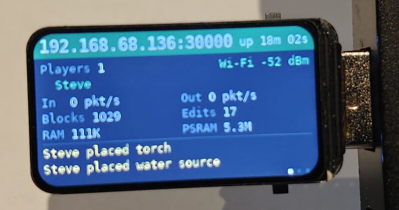
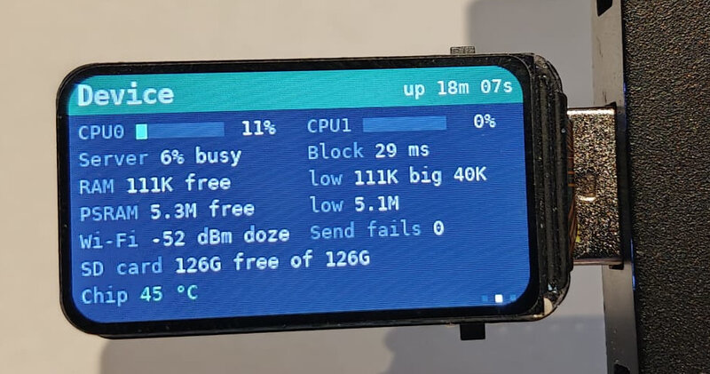
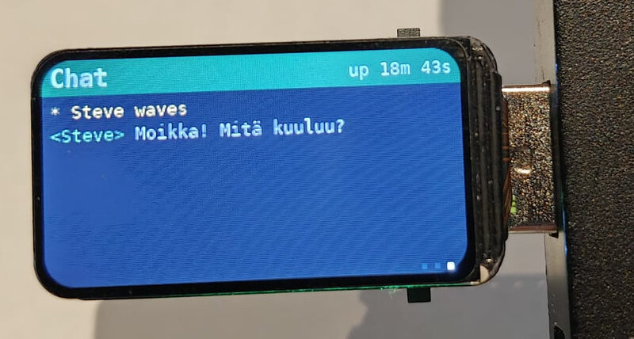
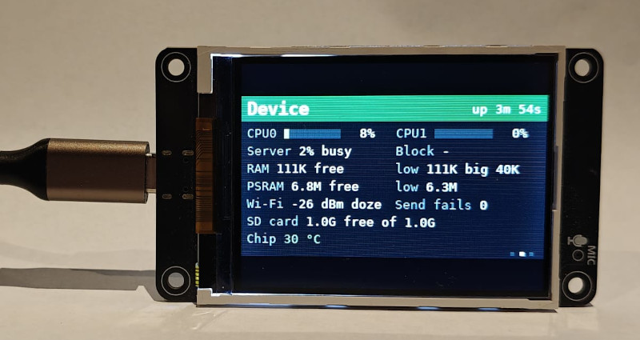
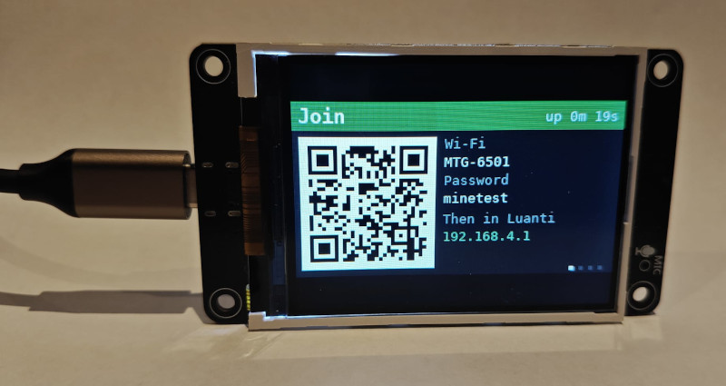

# esp32-s3-minetest

**Minetest on a $12 stick:** Minetest Game, rebuilt in Rust, running as a [Luanti](https://www.luanti.org/) server on a $12 ESP32-S3 board the size of a slightly oversized USB stick.

A standard, unmodified Luanti client connects to it over Wi-Fi as it would to any server. The board can join your access point, or run as its own free-standing hotspot. You can create an account, log in, explore a generated world with hills, forests, lakes, caves, lava and ores, dig and build, craft, smelt, farm, sleep through the night, and see the other players; testing shows it handles about six players. The world, accounts, inventories and player positions are stored on a microSD card, or, without one, in the board's own flash. The board's small LCD shows the server's status.

**Why "minetest" and not "luanti"?** When Minetest became Luanti, the point was to separate the engine (Luanti) from the game (Minetest Game). This project was first called esp32-s3-luanti, but it is really the other half: the server doesn't run Lua and can't load games or mods. It speaks Luanti's network protocol so that a normal client can connect, and everything else is Minetest Game (its nodes, recipes, furnace, doors, farming, beds and so on), built in, in about 20,000 lines of Rust. So it was renamed. The old GitHub link redirects here.

It covers roughly half of Minetest Game so far: see [What works](#what-works) and [What doesn't (yet)](#what-doesnt-yet).

<p align="center">
  
  
  
</p>

*The server running on a Waveshare ESP32-S3-LCD-1.47. Its built-in screen has three pages, switched with the BOOT button: overview, device and chat (and a fourth, Join, with a QR code for phones, when it runs as its own hotspot).*

<p align="center">
  
  
</p>

*The same server on an LCDwiki ES3N28P, here running as its own hotspot. At about 9 cm by 5 cm it is slightly larger and more expensive than the Waveshare, but it runs cooler and its 2.8" screen is easier to read. The repository can build for it: see [Other boards](#other-boards).*

## What it looks like

A Luanti client playing on the ESP32:


## Hardware

Developed on a [**Waveshare ESP32-S3-LCD-1.47**](https://www.waveshare.com/product/esp32-related/boards-kits/esp32-s3-lcd-1.47.htm):

| | |
|---|---|
| Chip | ESP32-S3, dual-core Xtensa LX7 at 240 MHz |
| RAM | 512 KB internal SRAM, plus 8 MB octal PSRAM |
| Flash | 16 MB |
| Display | 1.47" ST7789 LCD, 172 × 320 |
| Storage | microSD slot (4-bit SDMMC), optional |
| Network | 2.4 GHz Wi-Fi |


### Other boards

The firmware can also be built for LCDwiki's [**ES3C28P / ES3N28P**](https://www.lcdwiki.com/2.8inch_ESP32-S3_Display) (2.8" screen, with and without touch), with `BOARD=es3c28p` when building:

| | Waveshare ESP32-S3-LCD-1.47 (default) | ES3C28P / ES3N28P (`BOARD=es3c28p`) |
|---|---|---|
| Chip, memory | ESP32-S3 N16R8 | ESP32-S3 N16R8 |
| Display | 1.47" ST7789, 172 × 320 | 2.8" ILI9341V, 240 × 320 (touch on the C, unused) |
| Screen pins | SCLK 40, MOSI 45, CS 42, DC 41, RST 39, backlight 48 | SCLK 12, MOSI 11, CS 10, DC 46, reset with the chip, backlight 45 |
| microSD (4-bit) | CMD 15, CLK 14, D0 16, D1 18, D2 17, D3 21 | CMD 40, CLK 38, D0 39, D1 41, D2 48, D3 47 |
| RGB LED, button | GPIO 38, BOOT (GPIO 0) | GPIO 42, BOOT (GPIO 0) |
| Other | | speaker amplifier (kept off, GPIO 1), battery connector |

On the ES3C28P the status pages are drawn as on the Waveshare, 320 × 172, in the middle of the larger screen, for now. If its colours come out with red and blue swapped, or inverted, or the pages mirrored, flip `lcd_bgr`, `lcd_invert`, `lcd_mirror_x` or `lcd_mirror_y` for it in `src/board.rs` (both mirrors for pages upside down).

Flashing this board is most reliable with the flash erased first:
```
espflash erase-flash
BOARD=es3c28p WIFI_SSID='your network' WIFI_PASS='your password' cargo run --release
```
That wipes a world kept in the board's flash (one on an SD card is untouched). If the monitor still shows "waiting for download" after flashing, the board has restarted into its download mode rather than the new firmware: press its RESET button, and it starts normally.

Other ESP32-S3 boards with PSRAM and 16 MB of flash should work with a new entry in `src/board.rs` and their SD card and screen pins in `src/main.rs`; an SD card slot is optional. PSRAM is required: the server keeps its own data there and leaves the internal RAM to Wi-Fi and the system.

## What works

- **Protocol:** the Luanti network protocol as spoken by Luanti 5.17 (protocol version 53), including the reliable-UDP layer with split packets, acknowledgements, resends and out-of-order delivery.
- **Accounts:** SRP-6a password login, the same scheme the real server uses. New players register on first connect, and passwords are never stored or sent.
- **World generation:**
  - rolling hills and mountains;
  - Minetest Game's biomes: grassland, with coniferous forest in the hills; desert (desert sand over desert stone), savanna and rainforest in the hot lands, from dry to wet; cold desert (silver sand), tundra (permafrost, moss and stones, gravel beaches) and snowy fir forest in the cold lands, from dry to wet; snow on the mountain tops. Snow lies on the snowy lands and in patches on the tundra, and cold lakes freeze over;
  - gravel in blobs underground, and clay and gravel on lake beds;
  - caves with entrances; below height -64, in about half the land, they are flooded with lava, sealed off from the dry ones by solid stone;
  - dungeons (see below);
  - Minetest Game's ores, deeper for the better ones, at about its densities: coal everywhere, iron below 0, copper and tin below -64, gold below -256, mese below -512, diamond below -1024, and the odd mese block below -2048;
  - birch woods with apple trees in the lowlands and fir forests in the hills and snow, with clearings and the odd lone tree; dense jungle in the rainforest, with jungle grass on a floor of leaf litter; scattered flat-topped acacias in the savanna's dry grass. Leaves cast shade.
- **Trees, as in Minetest Game:** chop a tree's trunk away and its leaves fall within a few seconds (leaves you placed yourself never do). Leaves give a sapling one time in 20, dug or fallen. Plant a sapling on dirt, grass, savanna dirt or leaf litter in the open and it grows into a birch, fir, apple, jungle or acacia tree after 5 to 25 minutes, in daylight.
- **Apples and health:** apple trees carry apples. Pick one (punch it) and eat it (left-click with it) for 2 HP; health only comes back by eating, as in Minetest Game. A picked apple grows again in the same place after 5 to 25 minutes while the tree's leaves are there; apples fall with the leaves when the tree is chopped.
- **World edge:** the world ends about 31,000 nodes from the centre in every direction, at an invisible wall, as in Luanti.
- **World storage:** the world is generated on demand from a fixed seed. Only the changes players make are stored, as an append-only log on the SD card. Writing to the card is slow, so changes are appended once a second, and an inventory is saved within 5 s of changing (and when its player leaves): a power cut loses at most that much. Saving after every dig once held the server up so much that a player digging fast was disconnected.
- **Digging and building:** changes appear for every player at once. Sand (and, as in Minetest Game, gravel and the other sands) with nothing under it falls, under gravity, until it lands; what was stacked on it follows. Where it can't settle (on a torch, say) it drops as an item.
- **Survival inventory:** 32 slots, with stacks you can rearrange in the inventory window. New players start with 20 torches.
- **Crafting:** Minetest Game's 3×3 crafting grid in the inventory window, with its recipes and rules. Stone gives cobblestone, and ores give coal, iron, copper, tin and gold lumps, mese crystals and diamonds.
  - a tree trunk makes 4 planks (apple, birch, fir, jungle or acacia); planks make 4 sticks;
  - a coal lump above a stick makes 4 torches;
  - 4 sand make sandstone, and sandstone makes 4 sand; the same for desert sand and silver sand;
  - bricks and blocks from desert stone and from each sandstone; 4 clay lumps make clay, 4 clay bricks (clay lumps smelted) a brick block, 9 snow a snow block, 9 obsidian shards obsidian, and back; obsidian bricks and blocks from obsidian, obsidian glass from smelted shards. Gravel sometimes gives flint;
  - wooden and stone pickaxes, shovels, axes and swords, in Minetest Game's shapes (planks for wood, stone or cobblestone for stone);
  - a furnace from 8 stone or cobblestone in a ring;
  - a chest from 8 planks in a ring; a locked chest with a steel ingot in the middle, or from a chest and a steel ingot;
  - building blocks: 4 stone make 4 stone bricks and 9 make 9 stone blocks, and the same for sandstone; 9 coal lumps, steel, copper, tin, bronze or gold ingots, mese crystals or diamonds make a block of each, and back; 8 copper ingots round a tin one make 9 bronze ingots; a mese crystal breaks into 9 fragments, and 9 fragments make a crystal;
  - ladders: an H of sticks makes 5 wooden ladders, of steel ingots 15 steel ones.
  - lights: glass over a mese crystal makes a mese lamp; glass over three mese crystals in a row over planks makes 4 mese post lights of that wood, thin posts with glowing mese windows that light up as much as a lamp.
- **Stairs, slabs and corner stairs:** Minetest Game's, of each kind of planks, stone, cobblestone, each sandstone, desert stone and cobblestone, their bricks and blocks, brick, obsidian (and its bricks and blocks), ice, snow blocks, and the steel, copper, tin, bronze and gold blocks.
  - 6 blocks in a staircase (rising to the right) make 8 stairs, and 3 in a row make 6 slabs. 4 stairs in a square give 3 blocks back, and 2 slabs one above the other give 1.
  - Corner stairs: 6 blocks in a staircase shape with the middle left empty (one on top in the middle, one either side below, a full row underneath) make 7 inner corners; 4 as an upside-down T make 6 outer corners. They place like stairs, so which way a corner turns depends on where you stand.
  - Stairs face away from you. Placed against the underside of a block, or the upper half of its side, they go upside down. A slab placed on top of the same kind of slab joins it into a full block (or under it, if it is upside down), as in older Minetest Game; on a different slab it takes that slab's way up.
  - Light gets in, so a slab roof doesn't make a dark room. Wooden ones burn, for three quarters (stairs) or half (slabs) the time of the planks.
- **Doors:** Minetest Game's wooden, glass and steel doors: two columns of three planks, glass or steel ingots make one. A door faces the way you look as you place it, and one placed beside another hinges on the other side, so the pair opens outwards. Right-click opens and shuts it, with its sound; with sneak held, right-click builds against it instead. A steel door belongs to whoever placed it: only they can open or dig it (with a steel pickaxe). Owners are kept in `world/doors.txt`.
- **Fences, fence rails and fence gates:** Minetest Game's, in all five woods. Two rows of planks, stick, planks make 4 fences; two planks above two more, with an empty row between, 16 rails (a fence without its posts); two rows of stick, planks, stick a gate. Fences join up with each other, with gates and with planks and trunks next to them (the client draws the joins, from the node definitions). A gate is placed facing away from you, joins fences on its left and right, and opens and closes with a right-click and a creak. Rails join only fences, gates and other rails, and stop you like a fence does. Fences and gates burn for 5 to 7 s, as their planks, rails for 3 to 5 s.
- **Players are solid:** players can't walk through each other (in Luanti they can), except someone lying in bed. Everyone sees a teleported or respawned player where they now are straight away.
- **Walls:** Minetest Game's cobblestone, desert cobblestone and mossy cobblestone walls. Two rows of three cobblestone make 6. A wall is a thick post that grows a lower wall out to each wall, fence or stone block beside it, and stops you as a full block does. Fences and rails join walls too.
- **Dungeons:** Luanti's dungeon generator, ported from its source: underground rooms joined by corridors, some with stairs, walled in cobblestone that is mossy in places (desert stone in the desert). About four in ten mapchunks (80 nodes a side) have one, wherever there is stone, so they turn up in mines and caves at any depth, and now and then a room breaks out at the surface. As in Minetest Game, some rooms have a loot chest against a wall, up to two per mapchunk. What a chest holds depends on how deep it is: sticks, flint, apples, coal, gold and steel ingots, now and then mese crystals, a worn wooden sword, stone pickaxe or (rarely) diamond axe, sand and dirt near the surface (desert cobblestone and cactus in the desert), and obsidian and mese blocks below -512. Mossy cobblestone cooks back to stone, and makes stairs, slabs and walls.
- **Signs:** Minetest Game's wooden and steel signs: two rows of planks (or steel ingots) over a stick make 3. They hang on walls, lie on floors and hang under ceilings, and drop off when what they hang on is dug. Right-click one to write on it (up to 512 characters, over several lines); what it says shows, in quotes, when you point at it. Anyone who may interact can rewrite any sign, as in Minetest Game without protection. Wooden signs burn for 10 s. The text is node metadata, which the server keeps in `world/meta.txt` and sends with the map blocks, as Luanti does.
- **Paper, books and bookshelves:** three papyrus in a row make paper, three paper in a column a book, and three books between two rows of planks a bookshelf. A bookshelf holds 16 books (and nothing else), shows how many it holds when pointed at, and can only be dug when empty. It burns for 30 s.
- **Writing in books:** use a book (left-click with it in hand) to write a title and up to 10,000 characters in it; saved, it becomes a book with text, which shows its title and author in the inventory. Its author can go on editing it or read it; anyone else reads it, 14 lines a page. Saving a book with no title and no text leaves it an empty book (or makes it one again), where Minetest Game would keep a book with text titled "". A book with text and an empty book crafted together make a copy, and the original stays in the grid. What is written is kept in the item itself (Luanti's item metadata), so it goes wherever the book goes: chests, bookshelves, bones, dropped on the ground, other players.
- **Glass panes and steel bars:** Minetest Game's `xpanes`. Two rows of three glass, obsidian glass or steel ingots make 16. A pane on its own, or in a straight line, is a thin sheet running along the line; at a corner, a T or a cross it becomes a post with arms out to its neighbours. Panes join each other and stone, wood and trunks (not glass blocks, as in Minetest Game). Steel bars also make the **steel bar door** (two columns of three) and **steel bar trapdoor** (a square of four), locked to whoever places them like the steel ones.
- **Trapdoors:** Minetest Game's wooden and steel ones. Two rows of three planks make 2 wooden trapdoors, a square of four steel ingots one steel trapdoor. Placed like a block (facing away from you), right-click flips it up against its back edge and down again. A steel trapdoor is locked to whoever placed it, like a steel door.
- **Water:** lakes and ponds fill low ground up to height 1 (Luanti's water level), with sandy beds and shores; about an eighth of the land. Swim in it, and build into it. Water flows as in Luanti: dig beside or under a lake and it runs in, up to 8 nodes across flat ground, getting shallower as it goes, and falls down any hole; take the source away and the flow drains. Two sources with a gap between make a third, so a lake never runs dry. Water washes torches out. It spreads a node a second; the server looks at up to 1,000 places a second, so a flood into a big cave takes a while. Where more than 8 nodes in a map block change at once, the block is sent again whole rather than node by node, to spare the radio; while water is moving the log says how much every 10 s ("Liquids: ...").
- **Drowning:** as in Luanti, with your head in water (or lava) you lose a breath every 2 s, and with all 10 gone 1 HP every 2 s. Out of it, a breath comes back every half second. Luanti's bubbles show above the hotbar while your breath isn't full.
- **Lava:** Minetest Game's lava, in deep caves (see above) or poured from a bucket. It flows like water, but creeps (its depth changes a level at a time), never makes new sources, and burns 8 HP a second while you stand in it. Lava touching water cools: a lava source into obsidian (a steel pickaxe digs it), flowing lava into stone, with a hiss. It glows in the dark but lights nothing around it: the client draws lava bright by itself, and the server spends no time spreading its light. So that what players see stays the same, a change to lava is always sent as its whole map block, never node by node.
- **Flowers, dyes and wool, as in Minetest Game:**
  - Eight flowers grow in patches on the grassland (red rose, orange tulip, yellow and white dandelions, green chrysanthemum, blue geranium, viola, black tulip), mushrooms in the woods, and waterlilies on the swampy lakes of the rainforest and savanna. A waterlily goes back only on still water.
  - A brown mushroom heals 1 HP; a red one costs 5.
  - A flower makes 4 dye of its colour, a coal lump 4 black, blueberries 2 violet; two dyes mix into two of another (red and blue make violet, white and red pink, and so on: all 19 of Minetest Game's mixes), for all 15 colours.
  - Any wool with a dye makes wool of that colour. Beds take any colour of wool.
- **Other plants, as in Minetest Game:**
  - **Cactus** grows in the desert, with the odd large one with arms; **papyrus** on the swampy shores of the rainforest and savanna. Planted ones grow a node at a time, up to 4 tall, in daylight: cactus on sand, papyrus on dirt with water within 3 nodes. Digging papyrus takes the papyrus above it too. Five cactus in a plus make a large cactus seedling, which grows into a large cactus on sand.
  - **Bushes:** plain and blueberry bushes in the grassland, fir bushes among the firs and in the snow, acacia bushes on the savanna. Their leaves give a bush sapling one time in 5, their stems a plank. Pick blueberries for 2 HP each; the bush bears again 5 to 25 minutes later.
  - **Ferns** under the firs and **marram grass** on sandy lake shores.
  - **Kelp** on the beds of deep, cool lakes, up to 6 nodes tall, and **corals** (green, pink, cyan, brown, orange) in warm lakes. Digging kelp leaves the sand and gives the kelp, which goes back into sand with water above; a coral leaves its skeleton.
- **Farming:** Minetest Game's wheat and cotton.
  - Tall grass grows on grassland; digging it gives a wheat seed one time in five. Jungle grass in the rainforest gives a cotton seed one time in eight. Wild cotton grows in patches on grassland and savanna and gives cotton seeds.
  - A hoe (two planks, stones or steel ingots over two sticks, like Minetest Game's) turns dirt, grass or rainforest litter into soil with a left-click (not savanna dirt: Minetest Game makes that dry soil, which we don't have yet). Soil within 3 nodes of water turns wet; without water it dries, and bare dry soil turns back into dirt.
  - Plant seeds on soil. They sprout, then grow through 8 stages, a stage every 3 to 5 minutes, but only on wet soil in daylight. Dig a crop when ripe for one or two of the harvest and of seeds; earlier gives less.
  - 4 wheat make flour, which bakes into bread in the furnace (15 s); bread heals 5. 9 wheat make 3 straw blocks, and back. 4 cotton make white wool, 2 make 2 string.
- **Beds:** Minetest Game's simple bed (three white wool over three planks) and fancy bed (the same with a stick at the top right). A bed is two nodes long and points the way you look as you place it. Right-click it at night to lie down; a window shows how many players are in bed, and when everyone online is, the night is skipped to the morning (05:31). Once more than half are in bed, anyone lying down can force the night skip. Leave Bed (or Escape) gets you up again. Using a bed, by day or night, makes it where you respawn after dying; respawn points are kept in `world/beds_spawns`. A bed can't be dug while someone lies in it.
- **Buckets:** three steel ingots in a V make an empty bucket. Left-click water or lava with it to fill it; right-click to pour it out again, wherever you like. A lava bucket burns in a furnace for 60 s and leaves the empty bucket in the output.
- **Glass:** smelt any sand in the furnace. Turn on "connected glass" in Luanti's settings for Minetest Game's joined-up panes.
  - steel, bronze, mese and diamond pickaxes, shovels, axes and swords, from steel or bronze ingots, mese crystals or diamonds, with Minetest Game's digging times and wear. A diamond block needs a mese or diamond pickaxe; mese and diamond ore a steel one or better.
  - a mese lamp from glass over a mese crystal: a bright light.
- **Furnace:** Minetest Game's, placed facing you. Right-click opens it, with slots for what to smelt, fuel, and a 2×2 output.
  - It smelts iron, copper, tin and gold lumps into ingots, cobblestone into stone (desert cobblestone into desert stone), sand into glass, clay lumps into bricks and obsidian shards into obsidian glass, 3 seconds each, and bakes flour into bread in 15.
  - Fuel: lava buckets burn for 60 s, coal lumps 40 s, chests 30 s, trunks 22 to 38 s, wooden doors 14 s, beds 12 to 13 s, wooden trapdoors, fences and gates 5 to 9 s, fence rails 3 to 7 s, straw 3 s, planks 5 to 9 s, leaves, grass, torches and wooden tools a few seconds, sticks, wheat, cotton and string 1 s. A piece of fuel that is alight burns to the end.
  - It burns whether or not anyone has it open. While lit, its front shows the fire, it glows, the window's flame and arrow fill up, and you hear it.
  - Only fuel goes in the fuel slot, and nothing into the output. Empty it before digging it (with a stone pickaxe). Its contents are kept on the SD card in `world/furnaces.txt`.
- **Chests:** Minetest Game's, 32 slots, placed facing you. Right-click opens one: the lid lifts with a creak while anyone has it open (unless a block sits on it) and closes with a thud. A locked chest opens only for whoever placed it. Empty a chest before digging it. Contents are kept in `world/chests.txt`.
- **Tools:** Minetest Game's digging rules. The bare hand digs earth, sand, leaves and (slowly) wood, but not stone, so your first job is a wooden pickaxe. Iron ore needs a stone pickaxe. Tools wear with use, show Luanti's wear bar, and break with Minetest Game's sound: a wooden pickaxe lasts 30 stone digs, a stone one 60, a steel one 180 (and digs twice as fast).
- **Torches:** they mount on floors, walls and ceilings using Minetest Game's 3D models. The server computes their light, so caves and nights are lit, and they fall off when the block they hang on is dug.
- **Day and night:** a normal day and night cycle. Map blocks carry separate day and night light.
- **Health:** fall damage, a health bar, death and respawn.
- **Bones:** Minetest Game's. Die with anything on you and it all stays where you fell, in a bones block (in the nearest air if you died inside something, and on the ground if you died in mid-air; dropped on the ground if there is nowhere at all). Right-click to open them, or punch them to take everything that fits; once they're empty they go, and you get the bones block. At first only you can take from them; after 20 minutes of game time they become "old bones" and anyone may. Nothing can be put back in.
- **Dropped items:**
  - `Q` drops the whole stack in your hand; `Shift+Q` drops one;
  - punch an item to pick it up;
  - items fall, land, and merge with matching items nearby.
- **Up to six players at once:** a seventh is turned away with Luanti's "too many users" message. The limit is `MAX_PLAYERS` in `src/server.rs`; more players would overload the ESP32, mainly in generating map blocks when several explore at once.
- **Welcome message:** joining players are told what the server is and who else is on.
- **Chat:** with Luanti's usual limits (500 characters, 8 messages per 10 seconds, commands included), and Luanti's chat commands: see [Administrator and privileges](#administrator-and-privileges).
- **Changing your password:** from the client's own Change Password dialogue.
- **Sounds:** Minetest Game's footstep, digging, breaking and placing sounds for each kind of block, and a sound when you are hurt. The client plays them; the server only says which.
- **Players:** other players are shown with the animated Minetest Game character and their name tags.
- **Skins:**
  - chosen with a live 3D preview in the inventory window;
  - extra skins can be added on the SD card;
  - 64×64 Minecraft skins are accepted.
- **Saving:** player positions, health, skins and inventories are saved and restored. So are dropped items (they fall back to the ground after a restart, keeping how long they have left) and the time of day, so a restart carries on where the game was. The board is usually stopped by pulling the plug, so the time is saved every minute and items 10 seconds after they change: at most that much is lost.
- **Status light:** the board's RGB LED shows what is happening, whether the screen is on or off. It never goes above 60% of full power.
  - slow breathing while the server runs, a little quicker with players on: green, turning amber when the chip is warm (60 °C) and red when it is hot (75 °C), the same colours as the temperature on the Device page;
  - two blue flashes when a player joins, two purple when one leaves, and a white flash for chat;
  - three red flashes when something goes wrong, such as failing to save to the SD card;
  - amber blinking while looking for Wi-Fi.
- **Status screens:** the LCD has three pages, switched with the board's BOOT button, plus a fourth when the board runs its own hotspot. The screen switches off after a minute without a press, to keep the board cooler; the next press wakes it on the same page.
  - **Join** (hotspot only, first): a QR code that a phone camera offers to join, with the hotspot's name, password and address written beside it.
  - **Overview:** players online, packet and block counts, memory, and recent events.
  - **Device:** load on each CPU core, how busy the server is, time per map block, memory (free, lowest, largest piece), Wi-Fi signal and channel (on the hotspot: its channel and how many devices are on it), failed sends, SD card space (or flash space, without a card), and the chip's temperature.
  - **Chat:** the latest public chat, newest at the bottom. The screen font covers Latin-1 and Latin Extended-A, so Finnish, Swedish and most European letters show properly.

## What doesn't (yet)

- Much of Minetest Game is still missing: cave ice, TNT and fire, boats, carts, keys, weather and creative mode.
- No Lua mods: the game content is built in.
- One world per SD card (or in the board's flash).
- Only tested with Luanti 5.17 clients. Older clients down to protocol 37 are accepted but untested.

## Building

You need the Rust toolchain for Xtensa, plus `git` and Python 3 with the `venv` module. The ESP-IDF build creates its own Python environment inside `.embuild/` on the first run; you don't need to set one up. On Ubuntu: `sudo apt install git python3 python3-venv`.

1. Install the Rust Xtensa toolchain with [espup](https://github.com/esp-rs/espup), then load its environment (in every new shell, or from your shell profile):
   ```
   cargo install espup
   espup install
   . ~/export-esp.sh
   ```
   `rust-toolchain.toml` selects that toolchain (`esp`) for this project.
2. Install the linker wrapper and the flashing tool:
   ```
   cargo install ldproxy espflash
   ```
3. Connect the board by USB, then build and flash. Give your Wi-Fi details as environment variables the first time. The firmware writes them to `wifi.txt` on the SD card when it starts (see [Wi-Fi networks](#wi-fi-networks)), and they are not stored in the repository.
   ```
   WIFI_SSID='your network' WIFI_PASS='your password' cargo run --release
   ```
   `cargo run` flashes the board with `espflash`, with the partition table in `partitions.csv`, and opens the serial monitor.

   For the ES3C28P or ES3N28P, add `BOARD=es3c28p`:
   ```
   BOARD=es3c28p WIFI_SSID='your network' WIFI_PASS='your password' cargo run --release
   ```
   Switching between boards needs no `cargo clean`, but always give `BOARD` when building for the ES3C28P: a build without it is for the Waveshare.

**The first build is slow.** It downloads ESP-IDF v5.5.1 and its tools into `.embuild/` inside the project and compiles them.

**Rebuilding after configuration changes:** run `cargo clean` before building if you change `sdkconfig.defaults` or the ESP-IDF version (set in `.cargo/config.toml`). Neither change is picked up by an incremental build.

### Configuration

The ESP-IDF settings that matter, in `sdkconfig.defaults`:
- **Flash and PSRAM:** 16 MB flash and 8 MB octal PSRAM at 80 MHz, with PSRAM available to `malloc`.
- **Main task stack:** 32 KB.
- **Wi-Fi and network buffers in PSRAM:** `CONFIG_SPIRAM_TRY_ALLOCATE_WIFI_LWIP` lets them live there where possible. (ESP-IDF's iperf settings, with the buffers in internal RAM, were tried: no faster here, and internal RAM ran out under load.) Every minute the log reports the internal RAM left (`Internal RAM: ... KB free, lowest so far ... KB`) and warns below 16 KB.
- **CPU statistics:** `CONFIG_FREERTOS_GENERATE_RUN_TIME_STATS` lets the status screen show the load on each core.
- **UDP receive queue:** `CONFIG_LWIP_UDP_RECVMBOX_SIZE=32` lengthens it, so bursts of client packets aren't dropped while the server is busy.

## The SD card

Format the card as FAT32 and insert it before powering up. Any size will do: a world takes a few megabytes. The server creates what it needs:

```
/sd/auth/       accounts (salt and SRP verifier per player), <name>.privs (privileges, where not the default),
                admin.txt (the administrator's name) and ipban.txt (banned players)
/sd/world/      the world: nodes.log (every change made), furnaces.txt and chests.txt (their contents, and those of bones), items.txt (dropped items), doors.txt (steel doors' and trapdoors' owners),
                beds_spawns (where players respawn),
                env_meta.txt (the time of day, as Luanti keeps it) and the generator version
/sd/players/    <name>.inv (inventory) and <name>.player (position, health, skin, home)
/sd/media/      optional extra media (see below)
/sd/motd.txt    optional welcome message (see below)
/sd/wifi.txt    the Wi-Fi networks to join, and the hotspot (see below)
```

All of these are plain text or simple binary files, so you can inspect or edit them on a PC. If a future version changes the terrain generator, the old change log is kept as `nodes-v<n>.log` and the world starts afresh.

### Without an SD card

If no card is found at start-up, the server keeps everything in the board's own flash instead: an 11 MB partition (`storage` in `partitions.csv`), formatted as FAT the first time and mounted in the card's place, with ESP-IDF's wear levelling spreading the writes. The same files are kept there, and the Device page shows "Flash" in place of "SD card". Things to know:
- **Getting files in and out:** there is no card to put in a PC, so no editing `wifi.txt` or `motd.txt`, adding skins, or looking at the files there. Build with `WIFI_SSID` and `WIFI_PASS` (or use the hotspot) for the Wi-Fi settings; changing networks means reflashing.
- **Backups and moving a world:** a card can be copied in seconds; a world in flash belongs to that board, and there is no tool yet to copy it out.
- **The partition table:** `cargo run` writes it with the firmware (see `.cargo/config.toml`). Ordinary reflashing keeps the game, but flashing with a different table (for instance if the firmware ever outgrows its 5 MB), or erasing the whole flash, wipes it.
- **Space:** 11 MB. A world takes a few megabytes, so it is plenty for play, but leaves little room for extra media.
- **Wear:** flash lasts about 100,000 erases per sector. Wear levelling spreads the writes over the whole partition, so at the server's rate (changes saved once a second while people play) it should last many years, but unlike a card it can't be replaced.
- **A card and flash are separate:** a world started in flash stays there, and isn't seen while a card is in. One board holds one world in flash; cards let you swap between worlds.
- `RESET_SD=1` resets whichever is in use.

For tinkering, backups or more than one world, use a card; flash suits a fixed setup or a demo.

### Wi-Fi networks

The server joins Wi-Fi using `/sd/wifi.txt`, a plain text file you can edit on a PC:

```
network My Home Wi-Fi
password correct horse battery staple

network Office
password hunter2
```

Each `network` line starts an entry. Its `password` line is optional; leave it out for an open network. Everything after the first space is the value, spaces included. Lines starting with `#` are ignored.

How the server chooses a network:
- **Which one:** at start-up it scans, then joins the networks it can see, in the file's order. If none are in range it also tries the rest, in case one is hidden, and keeps retrying every 10 seconds. The LCD shows what it is doing.
- **If the connection drops** (the router restarts, or the signal goes), the server notices within a couple of seconds, tries the same network again, and then looks for any known network as at start-up. The game keeps running meanwhile; the LCD header shows "Wi-Fi..." and the status light blinks amber until it is back. Players whose clients haven't given up (after 30 seconds) carry on where they were.
- **Power saving:** after 30 seconds with nobody doing anything (no one connected, or every player standing still with their map loaded), the radio dozes between the router's beacons, which saves power and keeps the board's 3.3 V regulator cooler. The first move afterwards may arrive up to a few hundred milliseconds late; then the radio stays fully awake again. The Device page shows "doze" in place of the channel while it saves.
- **Building with Wi-Fi details:** if you build with `WIFI_SSID` and `WIFI_PASS`, that network is written to the top of `wifi.txt` the first time the new firmware starts, or its password is updated if it is already listed. After that the file is yours: later edits are kept, even through reflashing the same firmware. It is only rewritten if you build with a different network or password.
- **Building without them:** plain `cargo run --release` uses whatever `wifi.txt` holds.

### Its own hotspot

Where there is no Wi-Fi to join, the board can make its own network. Switch it on, and when the screen says "Hold BOOT now for a hotspot", hold the BOOT button for a second (it waits three seconds for this). Don't hold BOOT while plugging the board in: the chip then waits to be flashed instead of starting.

The hotspot is set in `wifi.txt` with a `hotspot` line, and the `password` line after it:

```
hotspot MTG-0BC4
password minetest
```

If the file has no `hotspot` entry, this default is added to the end of it at start-up (the rest of the file is left as it was). The four characters after "MTG-" are the last four hex digits of the board's hotspot MAC address, so boards near each other have different names; the screen's Join page shows the name. A file that still has the old default (`hotspot Luanti` with the password `LuantiLuanti`) gets the new one in its place; a name or password you set yourself is left alone. WPA2 needs a password of 8 to 63 characters; leave the `password` line out for an open hotspot. If the entry can't be used (a password too short, say), the server warns and runs the default instead.

On the hotspot, the server is at **192.168.4.1** (port 30000, Luanti's default), and hands out addresses to up to 8 devices. The screen opens on the Join page: point a phone's camera at the QR code to join, or type the name and password on a laptop, then connect Luanti to 192.168.4.1. There is no internet on the hotspot, so a phone may complain or drift back to mobile data; tell it to stay connected. The power saving described above is off on the hotspot, since the board is the access point.

The passwords are stored on the card in plain text, so treat the card accordingly.

### Welcome message

Players see a short welcome in the chat area when they join: what the server is, where the source is, and who else is playing. To use your own text instead, put it in `/sd/motd.txt`; each line becomes one chat line. The list of other players is still added at the end.

### Starting afresh

To wipe the world and start over, build with `RESET_SD=1`:

```
RESET_SD=1 WIFI_SSID='your network' WIFI_PASS='your password' cargo run --release
```

When that firmware starts, it deletes `/sd/auth`, `/sd/world` and `/sd/players`: every account, the world's changes, and all inventories and player files. The world is then generated afresh from the seed. Extra media in `/sd/media` are kept.

It happens once. Each `RESET_SD=1` build has its own token, which it writes to `/sd/reset-done` after the reset, so rebooting the board doesn't wipe the card again. Build without `RESET_SD` afterwards as usual. Alternatively, delete those three folders by hand with the card in a PC.

### Test kit

To try out crafting and building without gathering everything first, build with `TEST=1`:

```
TEST=1 WIFI_SSID='your network' WIFI_PASS='your password' cargo run --release
```

Every player then gets, once, 50 each of cobblestone, stone, sand, sandstone, the three kinds of tree trunk and planks, sticks, coal lumps, iron lumps, steel ingots, apples, wheat and cotton seeds, wheat and cotton. The value of `TEST` is the kit's name, recorded in the player's inventory file: rebuilding with `TEST=1` gives nothing more, and `TEST=2` (or any new value) hands out a fresh kit. A test build also grows saplings, apples and crops ten times faster, so a field of wheat ripens in a few minutes rather than an hour. Build without `TEST` for normal play.

### Extra media and skins

Textures and models are built into the firmware. A file in `/sd/media` with the same name as a built-in one replaces it, and new files are offered to clients as well.

To add a skin, put `skin_<name>.png` in `/sd/media` and restart. It appears in the skin chooser as "<Name>": for example, `skin_red_knight.png` appears as "Red knight". Both skin formats are accepted:
- **64×32:** the classic Minetest and old Minecraft layout;
- **64×64:** modern Minecraft skins. Luanti's player model has no place for their overlay layers, so only the top half is used.

## Connecting

1. Watch the serial monitor or the LCD for the board's IP address.
2. In Luanti, open **Join Game** and enter that address with port **30000**.
3. Pick a name and password; the first login creates the account.

The first player to log in to a new world becomes its administrator, so log in yourself before anyone else does.

## Administrator and privileges

Privileges work as in Luanti. Each player has a set of them, and chat commands check them.

- **New players** get Luanti's defaults, `interact` (dig, build, use and move items) and `shout` (chat). No fly, fast or noclip until the administrator grants them.
- **The administrator** has every privilege, always: they can't be revoked, kicked or banned. It is the first player to log in to a new world, or, for a world from before there was an administrator, the first to log in after the update. The name is kept in `/sd/auth/admin.txt`; to hand the role on, put another name there on a PC (one line) and restart. `/admin` shows who it is.
- **Privileges:** `interact`, `shout`, `fly`, `fast`, `noclip` (pass through blocks while flying), `teleport` (self), `bring` (teleport others), `settime`, `give`, `kick`, `ban`, `password`, `server`, `privs` (grant and revoke anything), `basic_privs` (grant and revoke only `interact` and `shout`, for a moderator) and `home` (`/sethome` and `/home`).

The commands, with Luanti's wording:

| Command | Privilege | What it does |
|---|---|---|
| `/help [all \| <cmd>]` | | The commands you may use, or how to use one |
| `/admin` | | Who the administrator is |
| `/privs [<name>]` | | Your privileges, or another player's |
| `/me <action>`, `/msg <name> <message>` | `shout` | An action, or a private message |
| `/status`, `/time` | | Players online and uptime; the time of day |
| `/grant <name> <privs> \| all`, `/revoke ...` | `privs` or `basic_privs` | Give or take away privileges, comma-separated: `/grant Jane fly, fast` |
| `/grantme ...`, `/revokeme ...` | `privs` or `basic_privs` | The same for yourself |
| `/haspriv <privilege>` | `basic_privs` | Who online has a privilege |
| `/sethome`, `/home` | `home` | Remember where you stand; go back there (one home each, kept over restarts) |
| `/time <hh:mm \| 0..24000>` | `settime` | Set the time of day |
| `/teleport <x>,<y>,<z> \| <name>` | `teleport` | Go to a place (`~` for where you are: `~ ~20 ~`) or to a player |
| `/teleport <name> <x>,<y>,<z> \| <name2>` | `bring` | Move another player (to a player: beside them, with room to stand) |
| `/give <name> <item> [<count>]`, `/giveme <item> [<count>]` | `give` | Items, by their name: `esp:torch`, `default:torch` or just `torch` |
| `/clearinv [<name>]` | `give` (`server` for others) | Empty an inventory |
| `/kick <name> [<reason>]` | `kick` | Disconnect a player |
| `/ban [<name>]`, `/unban <name \| address>` | `ban` | Ban an online player (their name and address), list bans, or lift one |
| `/setpassword <name> <password>` | `password` | Set a player's password, for one who has forgotten theirs |
| `/clearpassword <name>` | `password` | Clear it: their next login sets a new one, like a new account |
| `/kill [<name>]` | `server` | Kill a player, or yourself |

Privileges are kept in `/sd/auth/<name>.privs`, one line such as `interact,shout,fly`, and bans in `/sd/auth/ipban.txt`, one `address|name` line each; both can be edited on a PC. A banned player is turned away by name, and anyone from their address too (on the board's hotspot, addresses are handed out afresh, so the name is what counts). Setting a password holds the server up for about a third of a second.

## Project layout

```
src/main.rs        start-up: SD card or flash, Wi-Fi, LCD, and the memory allocator
src/board.rs       the boards it can be built for, and their pins
src/server.rs      the server loop: peers, reliability, and all game logic
src/protocol.rs    Luanti's UDP packet framing
src/messages.rs    building and parsing protocol commands
src/content.rs     node and item definitions, media
src/world.rs       the world: generated blocks, player changes, lighting
src/terrain.rs     terrain, biomes, caves and ores
src/dungeons.rs    dungeons, mossy cobblestone, and dungeon loot
src/meta.rs        node metadata (a sign's text) and signs
src/books.rs       writing in books (item metadata is in inventory.rs)
src/items.rs       dropped items and their physics
src/inventory.rs   inventories and inventory actions
src/crafting.rs    crafting recipes, the craft grid, and fuel
src/furnace.rs     furnaces, and moving items between inventories
src/chest.rs       chests (and the contents of bones)
src/bones.rs       bones
src/nature.rs      leaf decay, saplings and apples
src/clock.rs       the time of day, kept over restarts
src/stairs.rs      stairs and slabs
src/doors.rs       doors and trapdoors
src/farming.rs     farming: soil, seeds, crops, hoes
src/beds.rs        beds, sleeping and respawn points
src/fences.rs      fences, fence rails, fence gates and walls
src/panes.rs       glass panes and steel bars
src/plants.rs      cactus, papyrus, bushes, ferns, marram grass, kelp, corals
src/falling.rs     falling sand and gravel
src/colours.rs     flowers, dyes and wool
src/liquids.rs     flowing water and lava
src/privs.rs       privileges, the administrator and bans
src/commands.rs    chat commands
src/player.rs      saved player state
src/skins.rs       player skins
src/auth.rs        accounts; src/srp.rs, sha256.rs, sha1.rs: login crypto
src/zstd.rs        a small zstd compressor for map blocks
src/lcd.rs, screen.rs, font.rs, status.rs   the status display
src/storage.rs     safe file writes on FAT
media/             built-in textures and models
partitions.csv     the flash layout: firmware, and room for the game without an SD card
tools/loadtest.py  bot players for load testing (see below)
tests/             the tests: tests/run.py runs them all (see Testing below)
```

## Testing

The server can be tested on a PC, without the board. `tests/run.py` builds the server's code for the PC, runs the unit tests and a set of checks, verifies what the server sends at login the way the Luanti client reads it, and then runs about 20 network tests, each a scripted player (or two) on a fresh world:

```
python3 -m venv .venv && .venv/bin/pip install -r tests/requirements.txt   # once
.venv/bin/python3 tests/run.py
```

It needs stable Rust (through rustup) and Python 3, not the ESP-IDF tools, and takes about 10 minutes. See [tests/README.md](tests/README.md) for running single tests and how it works.

## Load testing

`tools/loadtest.py` starts bot players that log in and walk off in
different directions, so the server has to generate and send fresh map
blocks for each, as players exploring would. It needs only Python 3:

```
python3 tools/loadtest.py 192.168.68.137 --bots 5 --minutes 10
```

Every 10 seconds it prints each bot's distance walked, map blocks received
(in total, per second, and in KB per second), round trip time, longest silence from the
server, and packets it had to resend. Watch the board's Device page
meanwhile for CPU load and memory. The bots are saved like any player, so
each run carries on in new terrain. Real players count towards the limit
of six; a bot over the limit is turned away. `--help` lists the other
options (speed, how far apart they join, view range, names).

**Measuring Wi-Fi throughput.** Walking bots are limited by how fast the
board can generate terrain. To measure sending alone, have one bot stand
still where the terrain is already built:

```
python3 tools/loadtest.py 192.168.68.137 --bots 1 --speed 0 --minutes 1 --prefix Still
python3 tools/loadtest.py 192.168.68.137 --bots 1 --speed 0 --minutes 1 --prefix Still
```

The first run builds the blocks around the bot (and the server keeps up to
600 of them); the second gets them all from that store, so it measures how
fast they go out. At the end it prints how long the whole view took to
arrive, in blocks and KB per second. Run it the same way, from the same
place, before and after a change.

## Notes for hackers

- **Read the engine source.** The protocol has no separate specification. The Luanti source (`src/network/`, `src/server/`, `src/client/`) is the reference, and the comments in this code point to the functions they follow.
- **The Xtensa argument limit.** Functions here are kept to at most six argument words, counting a hidden pointer for large return values. A seventh argument is passed on the stack, and in one build it arrived corrupted, which crashed the server on the first packet. Group arguments into a struct instead; `server::Setup` is the example.
- **Two cores.** The server loop (network and game logic) runs on core 0, next to the Wi-Fi driver. Map blocks, the expensive part, are generated and compressed by a thread on core 1, working from a snapshot of the world's changes. Built blocks are cached, so players near each other share them. A block the world changed around while it was being built is built again.
- **Memory.** The global allocator in `main.rs` puts the server's data in PSRAM. Left to the default, small allocations fill the internal RAM, and then Wi-Fi sends fail and threads can't start.

## Licence

The code is released under the [MIT licence](LICENSE), except for the files that are translations of Luanti's or Minetest Game's own code, which keep their licence, the [GNU LGPL, version 2.1 or later](COPYING.LESSER):

- `src/dungeons.rs` (Luanti's dungeon generator, with Minetest Game's dungeon loot)
- `src/liquids.rs` (Luanti's flowing liquids)
- `src/commands.rs` and `src/privs.rs` (Luanti's chat commands and privileges)
- `src/items.rs` (Luanti's dropped items)
- `src/crafting.rs` (Luanti's recipe matching, with Minetest Game's recipes)
- `src/meta.rs` and `src/jsonstring.rs` (Luanti's node metadata and item strings, with Minetest Game's signs)
- `src/books.rs`, `src/furnace.rs`, `src/stairs.rs`, `src/nature.rs` and `src/plants.rs` (Minetest Game's books, furnace, stairs, leaf decay and saplings, and plants)

Each says so at its top, with the original copyright holders. The firmware built from all of it is a combined work; as the full source is here, anyone can change and rebuild the LGPL parts, as that licence asks. Files based on Minetest Game mods under the MIT licence (`src/bones.rs`, `src/panes.rs`, `src/doors.rs`, `src/beds.rs`, `src/farming.rs`, `src/colours.rs`) stay MIT, crediting those mods' authors at their top.

The media in `media/` have their own licences:
- **From [Minetest Game](https://github.com/luanti-org/minetest_game), CC BY-SA 3.0:** the player model `character.b3d`, the default skin `character.png`, the torch models and textures, and the item and tool pictures (`default_*.png`, `gui_*.png`). Also the doors, gate, farming and bed media (`doors_*`, `door_*.b3d`, `default_fence_overlay.png`, `default_fence_rail_overlay.png`, `farming_*`, `default_grass_*.png`, `wool_*.png`, `beds_*.png`), the flower and dye pictures (`flowers_*.png`, `dye_*.png`), the pane and steel bar media (`xpanes_*`), and the bones textures (`bones_*.png`). Their credits are in `media/LICENSE-character.txt`, `media/LICENSE-torch.txt`, `media/LICENSE-items.txt`, `media/LICENSE-doors.txt`, `media/LICENSE-farming.txt`, `media/LICENSE-beds.txt`, `media/LICENSE-flowers.txt`, `media/LICENSE-xpanes.txt` and `media/LICENSE-bones.txt`. If you redistribute these files, the CC BY-SA terms apply to them, whatever you do with the code.
- **Sounds from Minetest Game** (`default_*.ogg`, `player_damage.ogg`): CC BY-SA 3.0, CC BY 3.0 or CC0, with credits in `media/LICENSE-sounds.txt`.
- **The skins `esp_skin_wizard.png`, `esp_skin_elf.png`, `esp_skin_borgo.png` and `esp_skin_strider.png`:** made by Keir Finlow-Bates, licensed under [CC BY-SA 3.0](https://creativecommons.org/licenses/by-sa/3.0/).
- **The other `esp_*.png` textures:** made for this project and covered by the MIT licence.

Luanti is a trademark of its respective owners. This project is not affiliated with the Luanti project.
